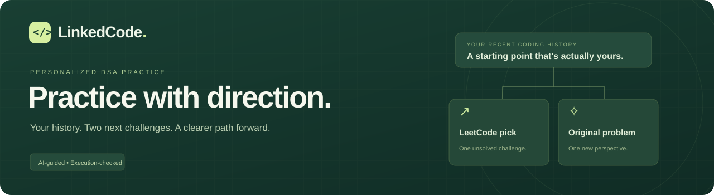
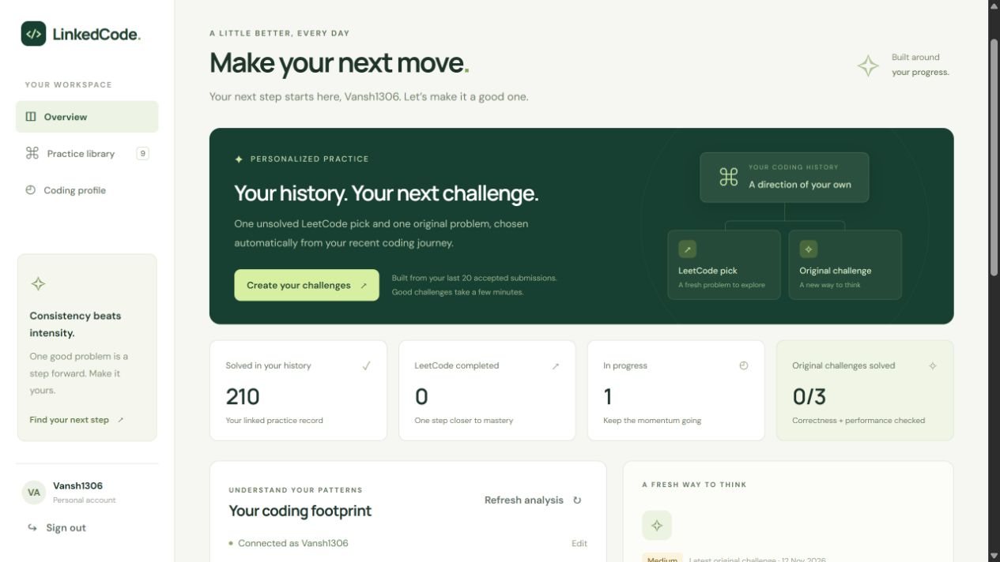
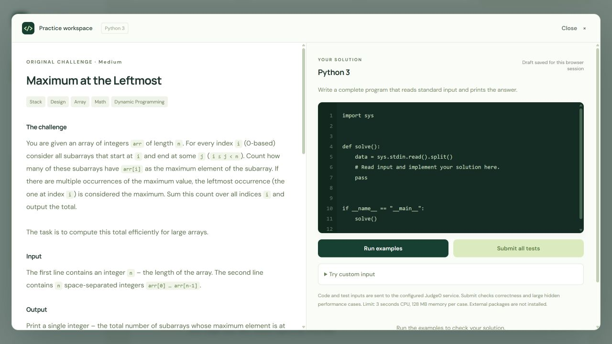
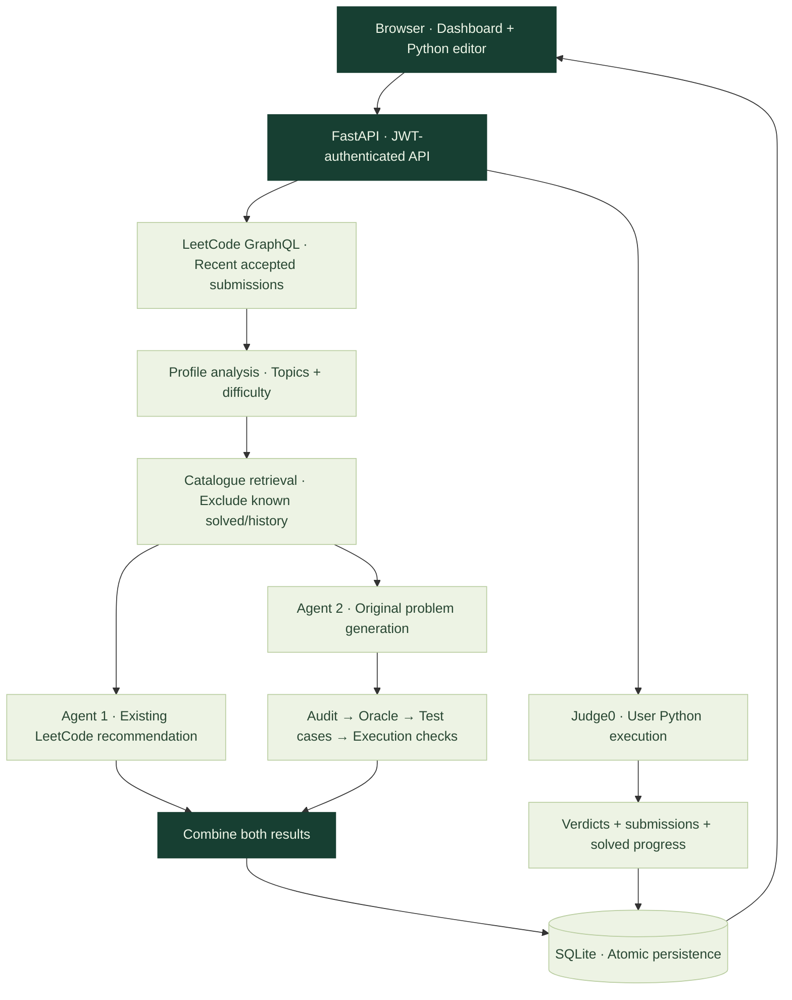

<div align="center">



<br />

**Your coding history should help you choose what comes next.**

An AI-powered DSA practice workspace that turns recent LeetCode activity into<br />
**one unsolved recommendation + one original challenge**, with a Python editor to solve it.

<br />


<br />

[Explore the UI](#preview) · [How it works](#architecture) · [Run locally](#quick-start) · [API reference](#api) · [Roadmap](#roadmap)

</div>

<br />

## The idea

Opening a problem list is easy. Knowing **what to practice next** is harder.

LinkedCode starts with your recent accepted LeetCode submissions, looks at the topics and difficulty you have been working with, and builds your next practice pair automatically. You do not have to pick a topic, choose a difficulty, or sift through another random list.

<table>
<tr>
<td width="33%" valign="top">

### 01 · Understand

Analyze up to **20 recent accepted submissions** and see your topic and difficulty patterns.

</td>
<td width="33%" valign="top">

### 02 · Challenge

Get **two ways forward**: an existing LeetCode pick and a newly generated original problem.

</td>
<td width="33%" valign="top">

### 03 · Solve

Write Python, run examples, submit against correctness and performance cases, and track your practice.

</td>
</tr>
</table>

> **The core promise:** your history drives the recommendation. The app does not ask you to configure your next question.

## Preview

### A practice space with a sense of direction

Sidebar navigation, a personalized challenge action, useful progress counts, topic analytics, and a searchable practice library.



### Read. Think. Write. Test.

A split problem-and-code workspace keeps the statement and Python editor independently scrollable. On smaller screens, **Problem / Code** controls help you move between them.



<sub>Local UI previews. Screenshots show development/QA data; this repository does not currently include a public hosted demo.</sub>

## Features

| Capability | What you can do |
| :--- | :--- |
| **History-based personalization** | Derive practice level and topic focus from recent accepted submissions. |
| **LeetCode recommendations** | Rank catalogue candidates and exclude known solved, previously recommended, and skipped questions. |
| **Original challenge generation** | Create a problem with a statement, constraints, examples, executable solutions, and complexity analysis. |
| **Correctness checks** | Audit solutions, generate an oracle, compare outputs, run stress tests, and validate the assembled problem. |
| **Python workspace** | Edit a complete stdin/stdout program, use four-space Tab indentation, and run examples with **Ctrl + Enter**. |
| **Performance-aware submissions** | Require both correctness and large hidden performance cases for full solved credit. |
| **Saved practice** | Browse original questions, reveal solutions, inspect submissions, and keep drafts for the browser session. |
| **Progress controls** | Mark LeetCode recommendations attempted, skipped, or completed; completion updates solved history. |
| **Authenticated ownership** | Use JWT authentication and user-scoped queries for questions, history, and submissions. |
| **Responsive interface** | Practice on desktop, tablet, or mobile without a frontend build step. |

**A note on personalization:** accepted submissions reveal recent exposure, not proven weaknesses. The profile is a recent sample, not an all-time LeetCode skill assessment. Solved-question exclusions also depend on the history stored in the local database.

## Architecture



The LangGraph workflow runs the recommendation and original-generation branches in parallel, joins their results, and saves the pair in one database transaction. If the second save fails, the first is rolled back too.

### Inside the original-question pipeline

| Stage | What happens |
| :--- | :--- |
| **Core generation** | Produce the statement, examples, both implementations, complexity claims, and a supported stress specification. |
| **Solution audit** | Check mathematical correctness, assumptions, edge cases, and complexity. |
| **Correction** | Apply a solution-only JSON patch. The backend preserves the original statement, examples, constraints, and stress specification. |
| **Oracle generation** | Request a separate executable implementation; reject exact structural duplicates and report similarity heuristics. |
| **Test generation** | Build **10 normal cases + 15 verification cases** with expected outputs filled by execution. |
| **Cross-validation** | Compare oracle and optimized outputs; also compare brute force on verification cases. |
| **Quality + stress checks** | Evaluate the problem and run generated stress cases before final solution validation. |
| **Persistence** | Save validated results and their validation report, associated with the authenticated user. |

An audited draft that still fails correction gets one fresh problem attempt. Retries are bounded. These checks improve confidence; LLM audits and AST similarity are not mathematical proofs of correctness or algorithmic independence.

## Quick start

### 1. Get the project

```bash
git clone https://github.com/AKSH4T-13/LinkedCode.git
cd LinkedCode
```

**Prerequisites:** Python 3.11+, internet access, and a Groq API key. The frontend uses plain HTML/CSS/JavaScript—no npm install or frontend build is required.

### 2. Create the environment

<details open>
<summary><strong>Windows · PowerShell</strong></summary>

```powershell
python -m venv venv
.\venv\Scripts\python.exe -m pip install -r requirements.txt
```

</details>

<details>
<summary><strong>macOS / Linux</strong></summary>

```bash
python3 -m venv venv
source venv/bin/activate
python -m pip install -r requirements.txt
```

</details>

### 3. Add private configuration

Create a `.env` file in the project root:

```dotenv
GROQ_API_KEY=your_groq_api_key
JWT_SECRET_KEY=replace_with_a_long_random_secret
```

Generate a JWT secret locally if needed:

```bash
python -c "import secrets; print(secrets.token_urlsafe(48))"
```

Keep the real `.env`, credentials, local user database, and any debug snapshots containing personal data out of public commits.

### 4. Start LinkedCode

**Windows:**

```powershell
.\venv\Scripts\python.exe -X utf8 -m uvicorn backend.main:app --reload
```

**macOS / Linux, with the environment activated:**

```bash
python -X utf8 -m uvicorn backend.main:app --reload
```

| Open | Address |
| :--- | :--- |
| **Dashboard** | [http://127.0.0.1:8000/app/](http://127.0.0.1:8000/app/) |
| **Interactive API docs** | [http://127.0.0.1:8000/docs](http://127.0.0.1:8000/docs) |
| **Health check** | [http://127.0.0.1:8000/health](http://127.0.0.1:8000/health) |

UTF-8 mode avoids Windows console errors when generated text contains mathematical symbols. The app creates its SQLite tables on startup at `backend/data/linkedcode.db`.

### 5. Make your next move

1. Register or sign in.
2. Link your LeetCode username and refresh your analysis.
3. Select **Create your challenges** once and keep the page open while generation runs.
4. Open your LeetCode pick, or solve the original challenge in the Python workspace.
5. Revisit your library and track your progress.

<details>
<summary><strong>Optional: run the frontend on its own port</strong></summary>

With the API already running:

```powershell
.\venv\Scripts\python.exe -m http.server 5500 --directory frontend
```

Open [http://localhost:5500](http://localhost:5500). Local CORS permits `localhost` and `127.0.0.1` on ports 5500 and 5173. The normal `/app/` setup needs only the FastAPI server.

</details>

## Python workspace

| Action | Checks | Saves a submission? | Grants solved credit? |
| :--- | :--- | :---: | :---: |
| **Run examples** | The problem's examples | No | No |
| **Custom input** | Runs stdin and displays stdout/errors; does not judge correctness | No | No |
| **Submit all tests** | Regular + verification cases, then hidden performance cases | Yes, after completed judging | Only if all stages pass |

Write a **complete Python program** that reads standard input and prints its answer. Standard-library solutions are supported; the app does not install arbitrary packages for a submission.

```python
import sys


def solve():
    data = sys.stdin.read().split()
    # Parse the input and implement your solution.
    # Print the answer in the question's required format.


if __name__ == "__main__":
    solve()
```

The editor keeps per-user/per-question drafts in browser session storage. Source code and test inputs are sent to the configured Judge0 service. JWTs, Groq credentials, and application environment variables are not forwarded. Submitted source and verdicts are saved in the local database.

### Correct is good. Efficient is better.

Small cases alone can let a quadratic solution slip through. Full Submit therefore uses a second stage:

1. Pass regular correctness and verification cases.
2. Build up to **three maximum-size hidden patterns** from the problem specification.
3. Calibrate reference outputs on the **same Judge0 runtime and limits** as the learner.
4. Cache the calibrated suite and judge the submitted code against it.

A broken or slow reference produces a review/service error rather than blaming the learner. Older small-case-only Accepted submissions remain in history as **Correctness only** and need a full resubmission for performance-aware solved credit.

<details>
<summary><strong>Runtime limits and judging details</strong></summary>

| Setting | Current implementation |
| :--- | :--- |
| Language | Python 3; configurable Judge0 language ID |
| CPU limit | 3 seconds per case |
| Wall-clock limit | 8 seconds per case |
| Memory | 128 MB per case |
| File/output limit | 64 KB requested from Judge0 |
| Network access | Disabled for submitted programs |
| Provider polling | Asynchronous submissions, bounded waits |
| Provider evaluation batch | Up to 90 seconds per batch; full Submit can use multiple batches |
| Account limits | One active run and a five-second cooldown; process-local |
| Performance input size | Supported specifications up to 200,000 elements |
| Output comparison | Whitespace-insensitive token comparison; no floating-point tolerance/custom checker |

Verification/performance data is omitted from execution results. Reference solutions and practice cases are revealable elsewhere in the app; this is a learning workspace, not a secure examination platform.

A fast algorithm should pass if it fits the actual constraints. Performance tests do not prove asymptotic complexity or reject every solution labelled brute force.

</details>

## Configuration

Only the first two variables are required for the main app. Optional execution examples are in [`tests/.env.execution.example`](tests/.env.execution.example).

| Variable | Purpose / default |
| :--- | :--- |
| `GROQ_API_KEY` | Required backend inference credential |
| `JWT_SECRET_KEY` | Required secret for signing authentication tokens |
| `GROQ_TPM_LIMIT` | Optional request-budget hint; defaults to `8000`. Does not increase the provider's quota. |
| `JUDGE0_URL` | Defaults to `https://ce.judge0.com` for development |
| `JUDGE0_PYTHON_LANGUAGE_ID` | Defaults to `100`; verify the ID on a different Judge0 instance |
| `JUDGE0_AUTH_TOKEN` | Optional token for a protected Judge0 instance |
| `JUDGE0_RAPIDAPI_KEY` | Optional key when using a configured RapidAPI Judge0 URL |

Judge0's public endpoint is an external development dependency; its availability, limits, and access requirements are outside this repository's control. See the [Judge0 API reference](https://ce.judge0.com/docs).

<details>
<summary><strong>Understanding Groq limits</strong></summary>

- **429** means the provider's minute/day allowance is exhausted. Repeatedly clicking Generate does not create more quota. Existing saved problems and Python execution do not consume Groq tokens.
- **413** means a request is too large for the available request budget; simply waiting may not fix it.
- The client uses phase-specific output reservations: recommendations up to **1,200**, audits **1,800**, oracle/test-case phases **2,500**, and core/correction/refinement **3,500** tokens.
- The local input estimate is conservative, not an exact model tokenizer. On a qualifying 413, the client can lower its completion reservation and retry the same complete prompt once.
- Prompt compaction removes repeated diagnostics and metadata; it does not truncate source code, constraints, or test inputs to force a request through.
- Daily quota exhaustion still needs better persistent cooldown/reporting and workflow resumption. Short in-process retries cannot solve a long daily-quota wait.

</details>

## API

Registration, login, and health checks are public. Practice endpoints require:

```http
Authorization: Bearer <access_token>
```

<details>
<summary><strong>Authentication and LeetCode profile</strong></summary>

| Method | Endpoint | Purpose |
| :--- | :--- | :--- |
| `POST` | `/auth/register` | Create an account |
| `POST` | `/auth/login` | Obtain a JWT |
| `GET` | `/auth/me` | Read the authenticated account |
| `PATCH` | `/auth/profile` | Link/update a LeetCode username |
| `GET` | `/leetcode/recent` | Fetch recent accepted submissions |
| `GET` | `/leetcode/analyze` | Analyze the recent submission sample |

</details>

<details>
<summary><strong>Challenges, history, and progress</strong></summary>

| Method | Endpoint | Purpose |
| :--- | :--- | :--- |
| `POST` | `/recommendations/generate` | Generate the personalized pair; no request body needed |
| `GET` | `/recommendations/history` | Read owned recommendation history |
| `PATCH` | `/recommendations/{slug}/status` | Set `recommended`, `attempted`, `completed`, or `skipped` |
| `GET` | `/practice/progress` | Read user-scoped progress counts |
| `GET` | `/generated-questions` | List saved original challenges |
| `GET` | `/generated-questions/{id}` | Read one owned original challenge |
| `GET` | `/health` | Public health check |

Completion is idempotent and records solved history in the same transaction. Completed LeetCode recommendations cannot be reopened. Other users' generated questions and recommendations are not exposed by owned-resource endpoints.

</details>

<details>
<summary><strong>Python execution and submissions</strong></summary>

| Method | Endpoint | Purpose |
| :--- | :--- | :--- |
| `POST` | `/generated-questions/{id}/execute` | Run examples/custom input or submit a solution |
| `GET` | `/generated-questions/{id}/submissions` | Latest 20 owned submission summaries |

```json
{
  "code": "import sys\nprint(sum(map(int, sys.stdin.read().split())))",
  "mode": "examples"
}
```

The JSON above illustrates the request shape; replace the code with a valid solution to the selected question. Supported modes are `examples`, `custom`, and `submit`. For custom input, add a `stdin` string.

The server chooses the saved test inputs and expected outputs. Requests cannot override judge cases, provider URLs, language IDs, or execution limits. LeetCode recommendations still open on LeetCode because this app does not own their judge suites.

</details>

## Tests

Tests and manual diagnostic scripts live in [`tests/`](tests/). Configuration is in [`tests/pytest.ini`](tests/pytest.ini); run commands from the repository root with explicit `tests/` paths.

**A focused, mocked set for the generation safeguards:**

```powershell
.\venv\Scripts\python.exe -X utf8 -m pytest tests/test_generation_input_contract.py tests/test_constraint_notation.py tests/test_solution_correction_patch.py tests/test_llm_token_budget.py -q
```

**Python judging and ownership checks:**

```powershell
.\venv\Scripts\python.exe -X utf8 -m pytest tests/test_python_runner.py tests/test_python_execution_api.py tests/test_performance_judge.py -q
```

**Inspect collection without running test functions:**

```powershell
.\venv\Scripts\python.exe -X utf8 -m pytest tests --collect-only -q
```

**Frontend syntax check, if Node.js is available:**

```bash
node --check frontend/script.js
```

Mocked API tests use isolated databases. Some legacy modules also perform local checks at import time. A directory-wide pytest run includes a live Groq check in `tests/test_llm.py`; manual generation and database helpers may consume quota or modify local data. See [`tests/README.md`](tests/README.md) before running those deliberately.

## Project layout

```text
LinkedCode/
├── backend/
│   ├── agents/                 # Recommendation, generation, refinement
│   ├── core/                   # JWT, password hashing, authenticated users
│   ├── graph/                  # LangGraph state, nodes, workflow
│   ├── llm/                    # Groq clients and token-budget handling
│   ├── routers/                # Auth, practice, Python execution APIs
│   ├── schemas/                # Request/response models
│   ├── services/               # LeetCode, candidates, validation, judging
│   ├── data/                   # Local SQLite and catalogue cache
│   ├── models.py               # Users, questions, history, submissions, suites
│   └── main.py                 # FastAPI + static frontend entry point
├── frontend/
│   ├── index.html              # Dashboard and practice workspace
│   ├── style.css               # Responsive visual system
│   └── script.js               # Auth, API flows, editor, results
├── tests/
│   ├── test_*.py               # Automated and integration checks
│   ├── assets/                 # README banner and interface previews
│   ├── artifacts/              # Local debug snapshots and failure reports
│   ├── pytest.ini              # Test/import configuration
│   └── README.md               # Test and manual-helper guidance
├── .gitignore
├── requirements.txt
└── README.md
```

## Tech stack

| Layer | Built with |
| :--- | :--- |
| Interface | HTML · CSS · JavaScript |
| API | FastAPI · Pydantic · Uvicorn |
| AI workflow | LangGraph · LangChain · Groq · `openai/gpt-oss-20b` |
| Persistence | SQLite · SQLAlchemy |
| Authentication | JWT · python-jose · Passlib/bcrypt |
| Coding data | LeetCode GraphQL |
| User code execution | Judge0 · Python 3 |
| Verification | pytest · mocked providers · isolated test databases |

## Roadmap

**Implemented**

- [x] Account authentication and LeetCode profile linking
- [x] History-driven recommendations and original-problem generation
- [x] Auditing, correction patches, oracle comparison, and stress checks
- [x] Atomic persistence, owned history, status controls, and progress
- [x] Responsive dashboard and integrated Python workspace
- [x] Maximum-size performance judging with calibrated, cached reference outputs

**Next**

- [ ] Isolate the generator's reference-code execution before public deployment
- [ ] Add persistent generation jobs, checkpoints, and quota-aware recovery
- [ ] Improve daily-limit cooldown and error reporting
- [ ] Add dedicated generators for supplied parent arrays, edge lists, and other structured inputs
- [ ] Add database migrations, pagination, and deployment configuration
- [ ] Explore C++ and Java execution after the Python workflow stabilizes

<details>
<summary><strong>Current scope and deployment boundaries</strong></summary>

- **Local development:** this is a functioning local application, not a production-hardened public deployment.
- **Two execution paths:** user editor submissions use Judge0. AI-generated solutions in the generation/validation pipeline still use the existing subprocess executor and need proper isolation.
- **Supported input shapes:** original problems currently use `N + N independent bounded integers`, optionally with an independent scalar `K`. Tree/Graph topics require implicit structures derived from those arrays. Supplied parent arrays, edges, or bounds like `P[i] < i` need dedicated valid-input generators.
- **Long-running work:** generation happens within the HTTP request. Durable background jobs and resumable phase state are not implemented yet.
- **Local persistence:** SQLite lives on disk; a hosting filesystem must not be treated as durable storage without appropriate configuration or a database migration.
- **Shared quotas:** changing the hosting provider does not increase Groq or Judge0 allowances. Process-local run locks/cooldowns are not distributed rate limiting.

</details>

---

<div align="center">

**Less random practice. More intentional progress.**

<sub>LinkedCode · Your history. Your next challenge.</sub>

</div>
